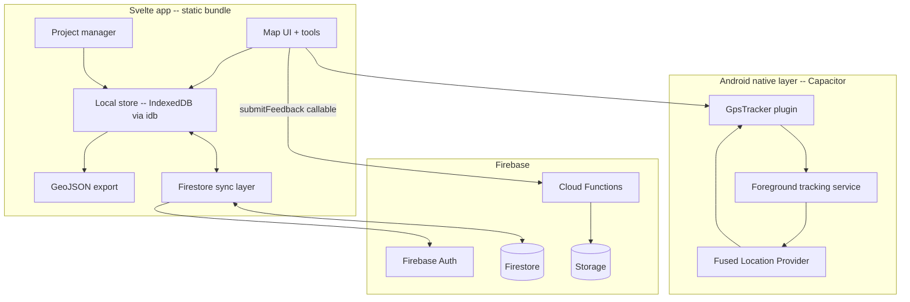

# Architecture overview

## Stack

SvelteKit 2 (`adapter-static`) · Svelte 5 (runes) · TypeScript (strict) · MapLibre GL JS + Protomaps PMTiles · Turf 7 · Capacitor 8 · Firebase / Firestore + Cloud Functions · Vitest.

The web build is fully static (prerendered) so the same bundle ships as a PWA and inside the Capacitor Android WebView.

## Shape

## Layering and data flow

1. **Capture is local-first.** All observations are committed to IndexedDB (via `idb`) before any network involvement. Creating or editing a feature never waits on the server. See [../decisions/0001-offline-first-local-write.md](../decisions/0001-offline-first-local-write.md).
2. **Simple location** (points, polygon corners) uses Capacitor Geolocation. **Continuous tracking** (screen-off, fixed interval, distance filtering, autosave) uses a **custom Android plugin + foreground service** — the Web/JS geolocation APIs cannot do reliable background capture. See [../decisions/0003-custom-android-tracking-plugin.md](../decisions/0003-custom-android-tracking-plugin.md).
3. **Sync is optional and per-project.** A project syncs to Firestore only when its `cloudSyncEnabled` is true and the session is eligible. See [../decisions/0005-per-project-cloud-sync-eligibility.md](../decisions/0005-per-project-cloud-sync-eligibility.md).
4. **Server access is rules-enforced.** Firestore and Storage rules deny direct
   client writes to sensitive paths; `submitFeedback` is the callable-only
   feedback write path. Closed-test enrolment is a user-operated Play flow, not
   a backend service.

## Cross-platform concerns

- **Geolocation typing**: web and Capacitor position types differ — code that handles both depends only on a minimal shared shape (`coords.latitude/longitude/accuracy/heading`).
- **Safe-area insets**: native bar heights come from `GpsTracker.getSafeAreaInsets()` exposed as `--sat`/`--sab`; `env(safe-area-inset-*)` is unreliable in the Capacitor WebView.
- **Visual viewport**: `--visual-viewport-height` is tracked on `visualViewport resize` to keep dialogs keyboard-safe on Android.

These are load-bearing invariants; their enforceable form is in [../development/conventions.md](../development/conventions.md).

## Component map

- `src/routes/` — pages: home, `/admin`, `/join/[token]`, `/offline-maps`, `/privacy`, `/tutorials`, `/projects/new`, `/projects/[id]` (+ `/export`, `/profiles`, `/track`).
- `src/lib/db.ts` — domain types and local persistence. See [data-model.md](data-model.md).
- `src/lib/components/` — shared UI (ProjectsPanel, DropdownMenu, PageHeader, ActionBar).
- `android/` — tracked Capacitor project and native tracking plugin. Local Firebase,
  signing, and deployment identity files remain ignored so each fork supplies its own.
- `functions/` — Cloud Functions (`submitFeedback`).

## Integrations

Backend/integration contracts (Firebase↔Streamlit, PostGIS mirror) are documented under [integrations/](integrations/index.md).
